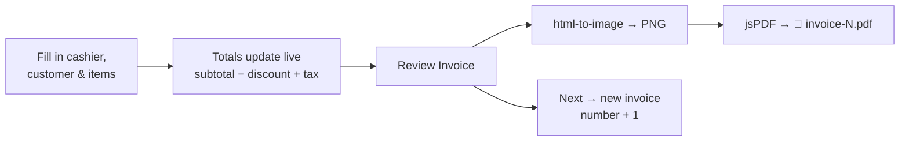

<div align="center">

# 🧾 Invoice Generator

**Create professional invoices in seconds — add items, apply tax and discount, preview the result and download it as a PDF.**

[](https://invoice-generator-six-neon.vercel.app)


[Features](#-features) · [How it works](#-how-it-works) · [Getting Started](#-getting-started) · [Structure](#-project-structure)

</div>

---

## ✨ Features

| | Feature | Details |
|---|---|---|
| 🧍 | **Cashier & customer** | Name both parties on every invoice |
| ➕ | **Dynamic line items** | Add, edit and remove items (name, quantity, price) |
| 🧮 | **Live totals** | Subtotal, tax %, discount % and grand total update as you type |
| 👀 | **Review modal** | See the finished invoice before you export it |
| 📥 | **PDF download** | Renders the invoice to an image and saves `invoice-<number>.pdf` |
| 🔢 | **Auto-numbering** | "Next" starts a fresh invoice with the number incremented (leading zeros preserved) |
| 📱 | **Responsive** | Tailwind CSS layout that works on phone and desktop |

## 🔄 How it works



<details>
<summary><b>🧮 Calculation</b></summary>

<br/>

```text
subtotal = Σ (price × qty)        (items with a name only)
discount = subtotal × discount% / 100
tax      = subtotal × tax% / 100
total    = subtotal − discount + tax
```

</details>

## 🚀 Getting Started

```bash
git clone https://github.com/Shariq2003/Invoice-Generator.git
cd Invoice-Generator
npm install
npm start            # http://localhost:3000
```

<details>
<summary><b>📜 Available scripts</b></summary>

| Command | What it does |
|---|---|
| `npm start` | Run the dev server |
| `npm run build` | Production build into `build/` |
| `npm test` | Run tests |

</details>

## 📁 Project Structure

<details>
<summary><b>Expand tree</b></summary>

```text
src/
├── components/
│   ├── InvoiceForm.jsx      # main form, state & totals
│   ├── InvoiceItem.jsx      # one line item row
│   ├── InvoiceField.jsx     # reusable input
│   └── InvoiceModal.jsx     # preview + PDF export
└── helpers/
    └── IncrementString.jsx  # "INV-009" → "INV-010"
```

</details>

---

<div align="center">

Built by **[Shariq](https://github.com/Shariq2003)** · [LinkedIn](https://www.linkedin.com/in/shariq-sd)

⭐ If you like this project, consider giving it a star!

</div>
